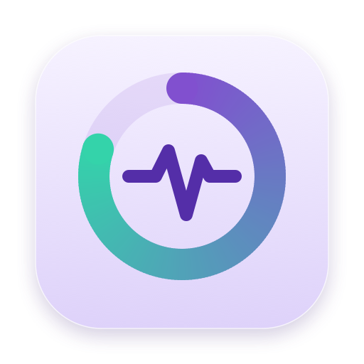

<p align="center">
  
</p>

<h1 align="center">Strata Monitor</h1>

<!-- readme-languages:start -->
<p align="center">
  <a href="../../README.md">English</a> · <a href="README.ja.md">日本語</a> · <a href="README.ko.md">한국어</a> · <a href="README.ru.md">Русский</a> · Українська · <a href="README.zh-Hans.md">简体中文</a> · <a href="README.zh-Hant.md">繁體中文</a>
</p>
<!-- readme-languages:end -->

<p align="center">
  Системний монітор, який живе в панелі меню macOS.<br>
  CPU, GPU, пам’ять, диск, мережа, батарея та пристрої з процесами, що стоять за кожним зчитуванням.
</p>

<p align="center">
  <a href="https://github.com/cristipufu/strata-monitor/releases/latest"></a>
  <a href="#install"></a>
  <a href="#install"></a>
  <a href="../../LICENSE"></a>
</p>

<p align="center">
  <a href="#menu-bar">Рядок меню</a> ·
  <a href="#panel">Панель</a> ·
  <a href="#explorer">Провідник</a> ·
  <a href="#system-processes">Системні процеси</a> ·
  <a href="#privacy">Конфіденційність</a> ·
  <a href="#install">встановити</a>
</p>

<p align="center">
  
</p>

<p align="center">
  &nbsp;
  &nbsp;
  
</p>

<a id="menu-bar"></a>

## Рядок меню

- **Три показання в одному предметі.** Кільце, центральне значення та смужка. Виберіть, що відображатиметься в налаштуваннях, і збережіть комбінації як профілі.
- **Наведіть курсор, щоб розгорнути.** Елемент відкривається в окремих читаннях, а пункти панелі меню ліворуч від нього, до того часу приховані, з’являються поруч. Доступ до спеціальних можливостей або запису екрана не потрібен.
- **Moments.** Елемент коротко показує, що щойно змінилося: живлення підключено або працює від батареї, низький рівень заряду батареї, новий вихід звуку, вимкнення звуку, підключений або видалений диск, розрив або відновлення мережі, підключення пристрою Bluetooth або процес, який триває хвилини. Додатково.

<p align="center">
  
</p>

<a id="panel"></a>

## Панель

Клацніть елемент для однієї вкладки на область. Кожна вкладка має однаковий макет, зверху вниз: сповіщення, поточне значення та його останню хвилину, процеси, які використовують найбільше, розподіл, останню годину чи день, потім списки та елементи керування вкладки.

| вкладка | Показує |
|---|---|
| **Огляд** | Статус Mac (CPU, пам'ять, температура, диск, GPU, живлення), живі плитки, найбільш завантажені процеси |
| **CPU** | Загальне навантаження, найбільш завантажені процеси, навантаження на ядро, тепловий тиск, історія |
| **GPU** | Завантаження GPU, рендеринг і геометрія, пам'ять GPU, процеси з використанням GPU, історія |
| **Пам'ять** | Використовуваний і тиск, найбільші процеси, активний, дротовий, стиснутий, кеш, обмін, історія |
| **Disk** | Вільний простір, найбільше процесів запису, швидкість читання та запису, обсяги |
| **Мережа** | Завантаження та завантаження, процеси з використанням мережі, інтерфейси, пошук портів, історія |
| **Акумулятор ** | Заряд і час, що залишився, потужність за процесом, джерело живлення, працездатність, що не дає Mac спати |
| **Wi-Fi** | Мережа та сигнал, увімкнення/вимкнення, найближчі мережі |
| **Bluetooth** | Сполучені пристрої, підключення/відключення, додаткові батареї |
| **Звук** | Гучність, вимкнення звуку, вихід |
| ** Відображає** | Режими, роздільна здатність і віддзеркалення попереднього перегляду з 15-секундним скасуванням, Keep Awake |

<p align="center">
  &nbsp;
  &nbsp;
  
</p>

**View All** на будь-якій вкладці відкриває Провідник, відсортований за мірою цієї вкладки. Значення, які ще не виміряні, показують "—", значення macOS не забезпечують відображення "Недоступно", а оцінки позначено як ≈.

<a id="explorer"></a>

## Провідник

Кожен процес на Mac, включаючи процеси інших користувачів і системи, а також порти та відкриті файли.

- **Процеси або сімейства**: плоский список або дерево процесів із підсумками для сімейства.
- **Пошук** за назвою, `pid:123`, `uid:501`, `user:root` або `port:3000`. **Show** фільтрує ваші процеси, інших користувачів, систему, програми, активні чи призупинені.
- **Columns** для часу CPU, потоків, живлення, пробудження, диска, GPU, стану, виду та часу початку.
- **Inspector** з недавньою історією, потужністю, GPU, підписом, аргументами та бібліотеками. Інтерпретатори та інструменти збирання показують свій проект, наприклад `bun · api`.
- **Actions**: призупинення та відновлення, вихід, завершення та примусовий вихід (підтверджено), вибірка протягом 3 секунд, зупинка процесу, утримуючи порт, експорт JSON. Комбінації клавіш у меню **Process**.
- **Timeline** тривалого CPU, потужності, зростання пам’яті та пробудження з історії.

Історія зберігається на Mac протягом 24 годин за замовчуванням (вимкнено, 24 години або 7 днів у налаштуваннях ▸ конфіденційність) і зберігає лише дані та назви процесів, а не шляхи чи аргументи.

<a id="system-processes"></a>

## Системні процеси

macOS надає додатку точні показання лише для процесів власного користувача. Без сторонньої допомоги Strata Monitor показує CPU інших процесів і пам’ять із `ps` Apple (позначений ≈).

**Show Exact Readings** додає додатковий помічник для решти:

- Одне натискання там, де показання відсутні, одне схвалення адміністратором у налаштуваннях системи.
- Лише читання: без вмісту файлу, аргументів, середовища, сигналів, інших інструментів або запису.
- Відповідає лише на Strata Monitor, підписаний тією ж командою, надає повні показання лише адміністраторам і виходить через 30 секунд простою. Вимкніть це в Налаштуваннях ▸ Конфіденційність.

<a id="privacy"></a>

## Конфіденційність

- Без облікового запису, відстеження, аналітики чи захоплення пакетів.
- Лише публічні інтерфейси macOS.
- Історія залишається на Mac.
- Якщо ви перевіряєте вручну або дозволяєте автоматичні перевірки, зверніться до GitHub. Системні показання не надсилаються.
- Розташування (імена Wi-Fi) і доступ до Bluetooth запитуються лише з їхніх вкладок.

<a id="install"></a>

## встановити

Завантажте [останній випуск](https://github.com/cristipufu/strata-monitor/releases/latest) і перемістіть Strata Monitor у програму. Потрібен кремнієвий Mac Apple із macOS 26. Релізи підписуються та завіряються нотаріально.

Збірка з джерела за допомогою Xcode 26 або Swift 6.2:

```sh
git clone https://github.com/cristipufu/strata-monitor.git
cd strata-monitor
scripts/build.sh release
open "build/Strata Monitor.app"
```

<a id="updates-and-languages"></a>

## Оновлення та мови

Використовуйте **Check for Updates…** у меню Strata Monitor або ввімкніть щоденні перевірки та автоматичне встановлення в **Settings ▸ General ▸ Updates**. Оновлення та канал оновлень підписані. Автоматичне встановлення відбувається, коли програма закривається.

Додаток підтримує 22 мови. Виберіть один у **Settings ▸ General ▸ Language**, потім закрийте та знову відкрийте програму або скористайтеся мовою, вибраною в macOS. Цей README доступний англійською, японською, корейською, російською, українською, спрощеною китайською та традиційною китайською.

<a id="development"></a>

## розвиток

```sh
scripts/test.sh            # all tests, with coverage
scripts/build.sh debug     # debug build in build/
scripts/benchmark.sh       # collection timings in build/benchmark.json
```

| Прапор запуску | Відкривається |
|---|---|
| `--preview` | Дослідник (`--preview-self`, `--preview-families`) |
| `--preview-page <tab>` | Панель на одній вкладці |
| `--preview-strip` | Розгорнутий пункт рядка меню |
| `--demo` | З будь-яким попереднім переглядом: створені дані замість цього Mac |
| `--appearance light\|dark` | З будь-яким попереднім переглядом: фіксований вигляд |
| `--render-glyphs <file.png>` | Пише дослідження елемента панелі меню |
| `--render-unfold <file.gif>` | Записує анімацію розгортання панелі меню |
| `--render-moments <file.gif>` | Пише анімацію моментів |

Попередній перегляд ніколи не змінює ваші налаштування. Перегляньте архітектуру [docs/IMPLEMENTATION.md](../../docs/IMPLEMENTATION.md).

<a id="releasing"></a>

## Звільнення

Введіть тег, що відповідає версії програми, наприклад `v0.1.0`. [Робочий процес випуску](../../.github/workflows/release.yml) перевіряє, підписує, передає на перевірку Apple та публікує образ диска та zip.

<a id="contributing-and-security"></a>

## Внесок і безпека

Звіти про помилки, переклади та код вітаються. Перегляньте [CONTRIBUTING.md](../../CONTRIBUTING.md), щоб дізнатися про налаштування та перевірки, і [SECURITY.md](../../SECURITY.md), щоб приватно повідомити про вразливість.

<a id="license"></a>

## Ліцензія

[MIT](../../LICENSE). Перегляньте [повідомлення третіх сторін](../../THIRD_PARTY_NOTICES.md) для програмного забезпечення в комплекті.
